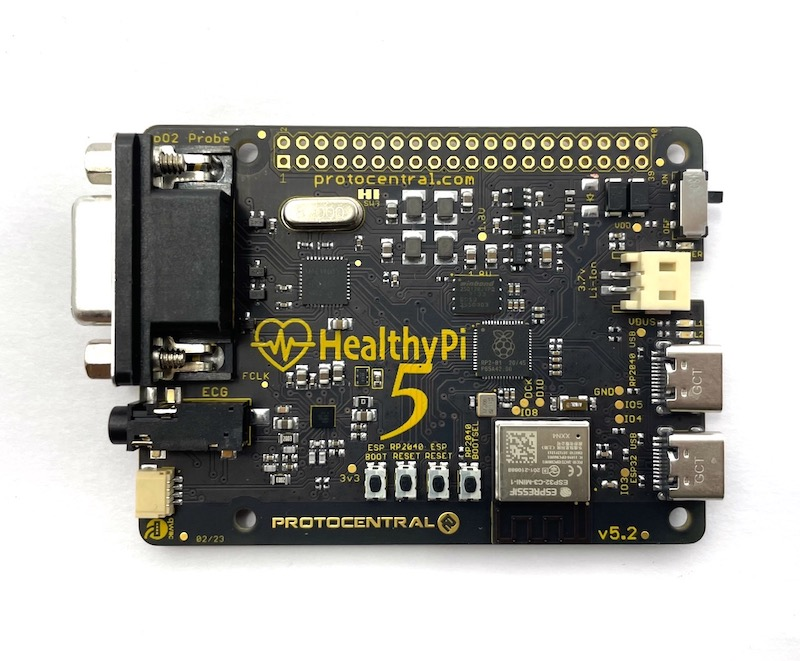
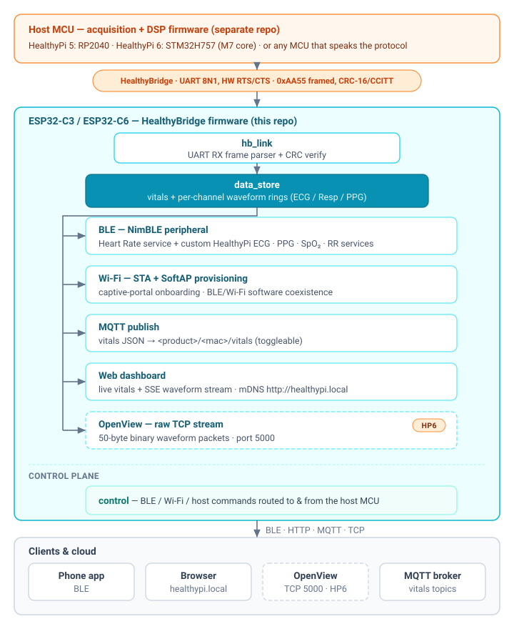

# HealthyBridge — BLE/Wi-Fi Bridge Firmware (ESP32-C3 / ESP32-C6, ESP-IDF)

[](https://github.com/Protocentral/healthybridge-esp32/actions/workflows/build.yml)

> **HealthyBridge** turns an ESP32-C3 or ESP32-C6 into a drop-in wireless
> co-processor: any host MCU speaks a small framed protocol over one UART, and
> this firmware bridges that data out over **BLE, Wi-Fi, MQTT and a local web
> dashboard** — the host needs no wireless stack of its own.
>
> It is **dual-target**: one codebase serves both ProtoCentral biosignal
> boards — **HealthyPi 5 NEXT** (ESP32-C3, with the RP2040 Main MCU as the UART
> host, separate repo
> [Protocentral/protocentral_healthypi_5_firmware](https://github.com/Protocentral/protocentral_healthypi_5_firmware))
> and **HealthyPi 6** (ESP32-C6, with the STM32H757 M7 core as the host). It is
> **not tied to HealthyPi** — any project that needs to add BLE/Wi-Fi
> connectivity to a UART host can use it.

<p align="center">
  
</p>

<p align="center">
  <b>Buy a HealthyPi 5:</b>
  <a href="https://protocentral.com/product/healthypi-5-vital-signs-monitoring-hat-kit/">ProtoCentral Store</a>
  &nbsp;·&nbsp;
  <a href="https://www.mouser.com/c/?m=ProtoCentral&q=HealthyPi%205">Mouser</a>
</p>

**HealthyBridge** is generic wireless-bridge firmware for the **ESP32-C3** and
**ESP32-C6**, built on the **Espressif IoT Development Framework (ESP-IDF)** with
the **NimBLE** Bluetooth stack. The design goal is separation of concerns: a host
MCU does all of the real work (sensing, DSP, control) and hands finished data to
the ESP32 over a simple framed UART link — the **HealthyBridge** protocol — and
this firmware re-exposes it over **BLE, Wi-Fi, MQTT and a local web dashboard**.
The host stays fully fault-isolated from the radio: if Wi-Fi or BLE stalls, the
host is unaffected.

The firmware serves two host products from one tree, selected at build time by a
**product profile** (`CONFIG_HB_PROFILE_HP5` / `CONFIG_HB_PROFILE_HP6`). The
frame codec, BLE/Wi-Fi/MQTT/dashboard consumers and the command plane are
shared; only the payload schema for two type IDs (`0x20` biosignal, `0x40`
vitals), the board pin map and the product identity strings differ. Only the
payload set (vitals/ECG/PPG) and the BLE service map are HealthyPi-specific —
the framing, transport and connectivity plumbing are reusable with any UART host.

## Supported targets

|  | HealthyPi 5 NEXT | HealthyPi 6 |
|---|---|---|
| Wireless MCU | ESP32-C3 | ESP32-C6 |
| Host MCU | RP2040 | STM32H757 (M7 core) |
| Host link | UART1, 921600 8N1, HW RTS/CTS | UART1 (M7 `UART4`), 2 Mbaud default |
| Profile | `CONFIG_HB_PROFILE_HP5` (default) | `CONFIG_HB_PROFILE_HP6` |
| Build / flash | `./hp5.sh`, `./flash_hp5.sh` | `./hp6.sh`, `./flash_hp6.sh` |
| Identity (BLE / dashboard / MQTT root) | `HealthyPi 5` · `healthypi5/` | `HealthyPi 6` · `healthypi6/` |
| Radios at boot | both started automatically | **off** until the host enables them |
| Flash layout (4 MB) | one 2 MB `factory` app ([`partitions.csv`](partitions.csv)) | two 1984 KB OTA slots + rollback ([`partitions.hp6.csv`](partitions.hp6.csv)) |
| Firmware update | USB only | USB; in the field through the host MCU (in development) |
| HP6-only consumers | — | OpenView TCP waveform streaming (port 5000) |

Each target keeps its own build directory and sdkconfig (`build.hp5` /
`sdkconfig.hp5`, `build.hp6` / `sdkconfig.hp6`), so the two never collide and
switching targets needs no clean. The mDNS hostname (`healthypi.local`) and the
SoftAP SSID prefix (`HealthyPi-XXXX`) are deliberately **not** product-scoped —
client tooling keys off them on both boards.

> The HealthyPi 6 consumer layer is still being brought up: the link, the HP6
> payload contract and the shared BLE/Wi-Fi/dashboard path build and run, but
> full app parity with the HealthyPi 6 monorepo is not complete.

## Hardware features (HealthyPi 5)

- **ESP32-C3** RISC-V co-processor with BLE 5 and 2.4 GHz Wi-Fi (this firmware)
- **RP2040** dual-core Main MCU running the acquisition firmware (separate repo)
- **MAX30001** (ECG / respiration) + **AFE4400** (PPG / SpO₂) analog front ends
- **MAX30205** I²C temperature and **MAX17048** battery fuel gauge
- MicroSD recording, Li-Ion charging, 40-pin Raspberry Pi HAT connector
- Dedicated USB Type-C to the ESP32-C3 for flashing and debugging

## Hardware features (HealthyPi 6)

- **ESP32-C6** RISC-V co-processor with BLE 5 and 2.4 GHz Wi-Fi (this firmware)
- **STM32H757** dual-core Main MCU (M7 core) running the acquisition firmware
- Wi-Fi TX power capped at **13 dBm** by default — peak transmit current is the
  largest term in the HealthyPi 6 power budget and the charger's input ceiling is
  strapped in hardware (`CONFIG_ESP_PHY_MAX_WIFI_TX_POWER`)

## Firmware features

- **HealthyBridge link** — UART frame parser (`0xAA55` framing, CRC-16/CCITT) consuming vitals/waveforms/battery from the host
- **BLE (NimBLE)** — advertises as "HealthyPi 5" or "HealthyPi 6" per the build profile; four standard SIG services plus the custom HealthyPi waveform and command services, so the existing phone app works unchanged (see below)
- **Wi-Fi STA** — connects with stored credentials, auto-reconnects, and falls back to the setup portal after repeated failures; BLE/Wi-Fi share the single 2.4 GHz radio via software coexistence
- **SoftAP captive-portal provisioning** — with no credentials, brings up an open `HealthyPi-XXXX` access point + captive DNS + HTTP form to onboard Wi-Fi, MQTT and dashboard settings, then reboots into STA
- **MQTT publish** — publishes vitals JSON to `<product>/<mac>/vitals` (`healthypi5/` or `healthypi6/`) once per second (toggleable, broker URI configurable). HealthyPi 5: `hr`/`spo2`/`rr`/`temp`. HealthyPi 6: the full record — `hr` (ECG only) and `pulse_rate` (PPG only) as separate keys plus `hr_src`, `spo2`, `rr`, `temp`, `hrv_sdnn`/`hrv_rmssd`/`hrv_lf_hf`, `flags` and `ecg_lead_off`/`ppg_weak`/`motion`; anything not available is `null` (see [`docs/PROTOCOL.md`](docs/PROTOCOL.md#healthypi-6-vitals-0x40))
- **Local web dashboard** — live vitals + Server-Sent-Events waveform streaming (ECG/PPG) with a JSON-poll fallback, battery / Wi-Fi RSSI / BLE status chips, lead-off warnings, a settings form and a re-provision button; advertised over mDNS at `http://healthypi.local`. On HealthyPi 6 the heart-rate card is labelled by its source ("Heart Rate (ECG)" / "Pulse Rate (PPG)"), unavailable vitals show `--`, HRV gets a chip, and ECG lead-off / weak PPG / motion raise the banner
- **Command plane** — BLE / Wi-Fi / host commands routed to and from the host MCU; status reported back once per second
- **OpenView streaming (HealthyPi 6)** — 50-byte binary waveform packets (type `0x02`) broadcast over raw TCP on port 5000 for the OpenView desktop client, plus one 27-byte `0x03` packet per vitals update carrying HRV and the vitals flags (which sensor produced the heart rate) (`CONFIG_HB_ENABLE_OPENVIEW`)
- **Version query (HealthyPi 6)** — the host's `GET_VERSION` (`0x31`) command is answered with this image's version from [`version.txt`](version.txt)
- **Deferred radio start (HealthyPi 6)** — the Wi-Fi and BLE stacks initialise at boot but neither radio is powered until the host asks, so a USB-powered unit doesn't brown out during the M7's bring-up (`CONFIG_HB_RADIOS_OFF_AT_BOOT`)

### BLE service map

Preserved verbatim from the legacy HealthyPi 5 firmware so existing clients keep working.

| Service | UUID | Characteristics |
|---|---|---|
| Heart Rate | `0x180D` | Heart Rate Measurement `0x2A37` |
| Battery | `0x180F` | Battery Level `0x2A19` |
| Pulse Oximeter | `0x1822` | SpO₂ Spot-Check `0x2A5E` |
| Health Thermometer | `0x1809` | Temperature `0x2A6E` |
| ECG + Respiration | `00001122-…` (128-bit) | ECG `00001424-…`, Resp `babe4a4c-…` |
| PPG + Resp-rate | `cd5c7491-…` (128-bit) | PPG `cd5c1525-…`, RR `cd5ca86f-…` |
| Command | `01bf7492-…` (128-bit) | TX (write) `01bf1528-…`, RX (notify) `01bf1527-…` |
| HP6 Vitals (HealthyPi 6 only) | `46db55ea-729e-4374-bae3-43d82bd59647` | Vitals `3d4b7342-5957-463d-97c3-b68e7fe21760` (read/notify): the 16-byte vitals record, flags included |

On HealthyPi 6, `0x2A37` carries the **ECG** heart rate only (0 while the rate
comes from PPG) with its sensor-contact bits set from ECG lead-off; the PPG pulse
rate, HRV and the quality flags are in the HP6 Vitals characteristic.
Respiration rate and temperature are not notified while unavailable. Details in
[`docs/PROTOCOL.md`](docs/PROTOCOL.md#healthypi-6-vitals-0x40).

## Host UART link

The host connects over **UART1, 8N1, with hardware RTS/CTS flow control**. Pins
are fixed per board in [`main/board_pins_hp5.h`](main/board_pins_hp5.h) and
[`main/board_pins_hp6.h`](main/board_pins_hp6.h).

**HealthyPi 5** — ESP32-C3 ↔ RP2040, 921600 baud (frozen by the wire contract):

| ESP32-C3 | GPIO | dir | RP2040 |
|---|---|:---:|---|
| TX  | GPIO6 | → | RX (P25)  |
| RX  | GPIO7 | ← | TX (P24)  |
| RTS | GPIO5 | → | CTS (P26) |
| CTS | GPIO4 | ← | RTS (P27) |

**HealthyPi 6** — ESP32-C6 ↔ STM32H757 `UART4`, 2 Mbaud by default
(`CONFIG_HB_UART_BAUD_HP6`; bring a new board up at 921600 first):

| ESP32-C6 | GPIO | dir | STM32H757 M7 |
|---|---|:---:|---|
| TX  | GPIO19 | → | `UART4_RX`  (PI9)  |
| RX  | GPIO22 | ← | `UART4_TX`  (PA0)  |
| RTS | GPIO20 | → | `UART4_CTS` (PB0)  |
| CTS | GPIO21 | ← | `UART4_RTS` (PA15) |

Note the crossover in both pairs — TX meets RX and RTS meets CTS. Wiring either
pair straight through is the most likely bring-up mistake, and it presents as a
completely silent link.

## Architecture

<p align="center">
  
</p>

## Install prebuilt firmware (no build)

The easiest way to flash or update a HealthyPi 5 ESP32-C3 — no toolchain required.
Releases currently carry the **HealthyPi 5 (ESP32-C3)** image only; build
HealthyPi 6 from source with `./hp6.sh` (below).

From the [latest release](https://github.com/Protocentral/healthybridge-esp32/releases/latest),
download `healthybridge-esp32-merged.bin` (and the app-only binary if updating)
plus `flash.sh`/`flash.bat`, then `pip install esptool` and run:

```bash
./flash.sh <PORT>                 # full install (merged image @ 0x0)
./flash.sh <PORT> --app-only      # update the app only (@ 0x10000)
```

> A **full** install (merged image at `0x0`) overwrites
> the NVS region, so it **erases stored Wi-Fi credentials and settings** — you'll
> re-provision over the SoftAP captive portal afterwards. Use `--app-only` to
> update the firmware while keeping settings. The HealthyPi 5 target has no
> over-the-air (OTA) update path, by design: its partition table has a single
> `factory` app, so updates are over USB/serial only.

HealthyPi 6 images are not in releases yet. Every CI run of the `firmware-hp6`
job uploads one as a build artifact (`healthybridge-hp6-esp32c6-firmware`):
unpack it and use `./flash_hp6.sh` from inside it, as described under
[Flashing a HealthyPi 6](#flashing-a-healthypi-6).

## Getting started

### 1. Install ESP-IDF

This firmware targets **ESP-IDF v6.0** or later; CI builds with **v6.0.1**, the
version the managed components in [`dependencies.lock`](dependencies.lock) were
resolved against. Follow the official ESP-IDF Get
Started guide for your target —
[esp32c3](https://docs.espressif.com/projects/esp-idf/en/latest/esp32c3/get-started/)
(HealthyPi 5) or
[esp32c6](https://docs.espressif.com/projects/esp-idf/en/latest/esp32c6/get-started/)
(HealthyPi 6) — then load the environment in your shell:

```bash
. $IDF_PATH/export.sh
```

### 2. Clone the repository

```bash
git clone https://github.com/Protocentral/healthybridge-esp32.git
cd healthybridge-esp32
```

The MQTT and mDNS managed components are fetched automatically by the IDF
component manager on first build (from [`dependencies.lock`](dependencies.lock));
they are not vendored in the tree.

### 3. Build

Each target has a wrapper script that pins the chip, the sdkconfig and the build
directory, so the two never interfere:

```bash
./hp5.sh          # HealthyPi 5  — esp32c3, build.hp5, sdkconfig.hp5
./hp6.sh          # HealthyPi 6  — esp32c6, build.hp6, sdkconfig.hp6
./hp6.sh merge    # ...plus one merged image, build.hp6/healthybridge-hp6-merged.bin
```

(`./build.sh` is the older HealthyPi 5-only wrapper around a plain `idf.py`
build in `build/`; it is what the release job runs. It refuses to build if the
root `sdkconfig` was made for another chip or the HealthyPi 6 profile —
`./build.sh fullclean` starts it fresh.)

HealthyPi 6 builds with `-Os`; CI fails if its app grows past 85% of an OTA
slot (`tools/check_app_size.py`).

The firmware version is the semver in [`version.txt`](version.txt). ESP-IDF
embeds it in the app descriptor, and the boot log prints it:
`HealthyBridge 1.1.0 for HealthyPi 6 (esp32c6) starting`.

`sdkconfig.hp5`/`sdkconfig.hp6` are seeded once from `sdkconfig.defaults` plus
the per-profile defaults and **ignored thereafter** — after editing a defaults
file, run `./hp5.sh clean` (or `./hp6.sh clean`) or the old value stays in force.

### 4. Flash & monitor

Connect the ESP32 USB Type-C port and flash:

```bash
./hp5.sh flash <PORT>       # HealthyPi 5: build + flash
./hp5.sh monitor <PORT>     # Ctrl-] to exit
```

`flash_hp5.sh` / `flash_hp6.sh` flash an already-built image with esptool alone,
with no ESP-IDF environment needed. For HealthyPi 6, read the next section
first.

#### Flashing a HealthyPi 6

1. **Release the C6 from reset.** On HealthyPi 6 the M7 holds the ESP32-C6 in
   reset from boot, with both radios off, and a C6 held in reset does not
   enumerate its USB port. Flashing then fails as if the hardware were dead.
   Release it from the host first:

   ```bash
   healthypi conn enable --radios none     # or `hpi link on` on the M7 dev shell
   ```

   Nothing persists this: after every reboot of the board the C6 is held again.

2. **First flash of the A/B layout: full erase plus the merged image.** A unit
   that last ran firmware with the old single-`factory` partition table must
   be moved onto the new table this way. A table cannot change any other way,
   and this one cannot change over the air at all:

   ```bash
   ./hp6.sh                      # build (needs esptool v5+ for the next step)
   ./flash_hp6.sh <PORT>         # erase the whole chip, write the merged image @ 0x0
   ```

   This **erases stored Wi-Fi credentials and settings**: re-provision
   afterwards.

3. **Later app-only updates** keep stored settings:

   ```bash
   ./flash_hp6.sh <PORT> --app-only
   ```

   This reads the offsets from the build, refuses if the unit's partition table
   does not match the build's, writes the app to `ota_0` and resets `otadata`,
   so `ota_0` boots next.

`./hp6.sh flash <PORT>` (plain `idf.py flash`, no erase) is fine for the
edit-build-flash loop on a unit that is already on the A/B layout.

### Host tests

The frame codec, the OpenView packer, the HealthyPi 6 vitals / `GET_VERSION`
contract (golden bytes and the mapping onto each consumer) and the portal page
substituter have plain-C unit tests that need no ESP-IDF. CI runs them on every
push:

```bash
test/run_host_tests.sh
```

### First-time provisioning

With no stored Wi-Fi credentials the device starts a **SoftAP captive portal** —
join its `HealthyPi-XXXX` access point and a form will open to enter your Wi-Fi
SSID/password and toggle the MQTT and dashboard options. The device then reboots
into station mode; the dashboard is reachable at **http://healthypi.local**.

## Firmware updates and rollback (HealthyPi 6)

The HealthyPi 6 image uses an A/B partition table, so that the C6 can later be
updated in the field through the M7 over the HealthyBridge link. That updater is
still in development; what is in place now is the layout and the rollback it
depends on.

| Offset | Partition | Size | |
|---|---|---|---|
| `0x0` | bootloader | 32 KB | rollback enabled; never updated over the air |
| `0x8000` | partition table | 4 KB | |
| `0x9000` | `nvs` | 24 KB | same place as HealthyPi 5: settings survive app updates |
| `0xF000` | `phy_init` | 4 KB | |
| `0x10000` | `otadata` | 8 KB | which slot boots, and whether it has been verified |
| `0x20000` | `ota_0` | 1984 KB | |
| `0x210000` | `ota_1` | 1984 KB | ends at the top of the 4 MB flash |

An image installed by an OTA update first boots **pending verification**. It
keeps its slot only after it has received valid frames from the host over the
HealthyBridge link. That link is the update path, so an image that cannot hold
it must not stay installed. If the frames do not arrive within 60 s, or the C6
resets before they do, the bootloader returns to the previous image. If there
is no previous image to return to, the new one keeps running. An image flashed
over USB is trusted as-is: the bootloader records it as valid on first boot.
The details are in [`main/ota_selftest.c`](main/ota_selftest.c), and the timeout
and frame count are Kconfig options (`HB_OTA_SELFTEST_*`).

HealthyPi 5 keeps its single `factory` partition and has no OTA path.

## Security considerations

This firmware is designed for trusted local networks (lab benches, personal
LANs). It is **not hardened for hostile or untrusted networks**:

- The provisioning **SoftAP is an open network** (no password) so onboarding
  needs no pre-shared key. Anyone in radio range during provisioning can join it
  and submit the form. Provision somewhere you trust.
- Neither the **captive portal nor the dashboard has authentication**. Any host
  on the same network can read vitals, change MQTT/dashboard settings, and
  trigger a Wi-Fi re-provision. Both serve plain **HTTP**, not HTTPS.
- **OpenView TCP streaming** (HealthyPi 6) accepts any client that connects to
  port 5000 — it is an unauthenticated, unencrypted waveform broadcast.
- **Wi-Fi credentials are stored unencrypted in NVS.** Enable NVS encryption
  (and flash encryption) if physical access to the board is a concern.
- **MQTT** connects with whatever the broker URI specifies; `mqtt://` is
  unencrypted. Use `mqtts://` with a broker that supports TLS if the vitals
  stream leaves your network.
- **Firmware images are not signed, and the ESP32 does not verify them** — there
  is no secure boot. Anyone with access to its USB port can reflash it. On
  HealthyPi 6 the planned in-field update path has the M7 check the image's
  signature before installing it; the bootloader rollback described above
  guards against a broken image, not a malicious one.
- Leave `HB_WIFI_DEFAULT_SSID`/`HB_WIFI_DEFAULT_PASS` in [`main/cfg.h`](main/cfg.h)
  **empty** in anything you build for others — they are a bench-testing
  convenience that bakes credentials into the binary.

## Documentation

The HealthyBridge wire protocol, the BLE service map, and the Wi-Fi / MQTT /
dashboard design notes live under [`docs/`](docs/). The frozen HealthyPi 5
contract is [`main/healthybridge.h`](main/healthybridge.h); the additive
HealthyPi 6 payloads and the unified frame-type table are in
[`main/healthybridge_hp6.h`](main/healthybridge_hp6.h). The companion Main-MCU
firmware for HealthyPi 5 is at
[Protocentral/protocentral_healthypi_5_firmware](https://github.com/Protocentral/protocentral_healthypi_5_firmware).

## Licensing

First-party firmware is **MIT** (see [LICENSE](LICENSE)). ESP-IDF and the managed
components (NimBLE, esp-mqtt, mDNS) retain their own licenses — see
[THIRD_PARTY_LICENSES.md](THIRD_PARTY_LICENSES.md).
